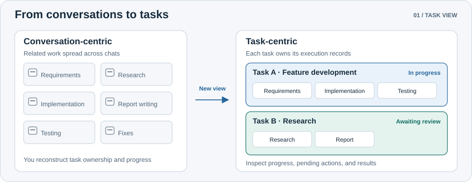
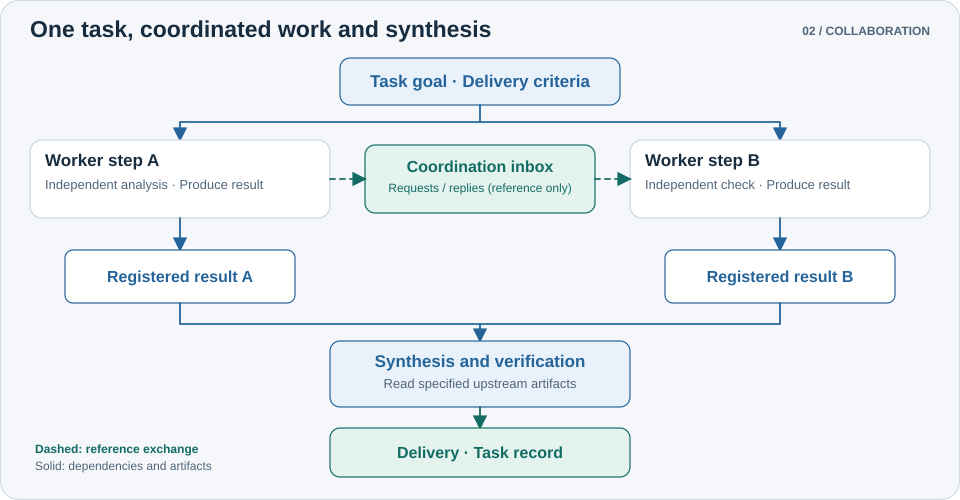
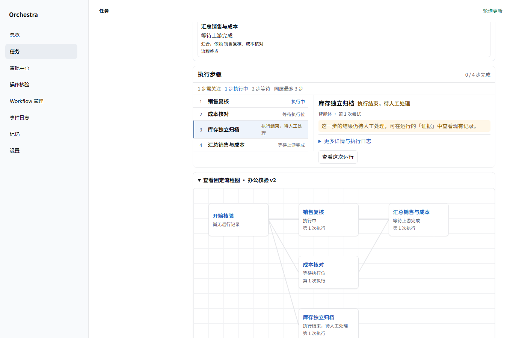
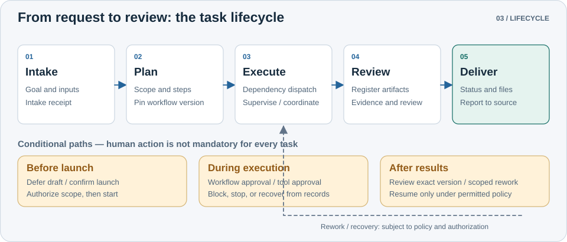
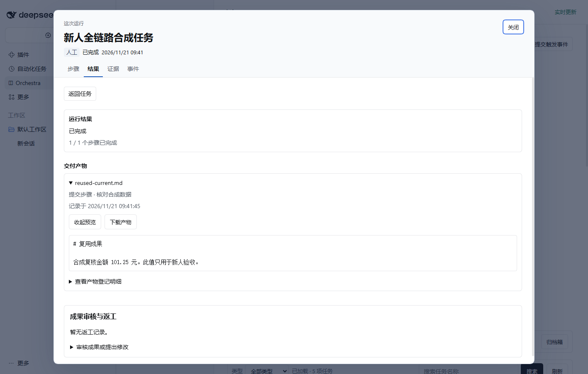
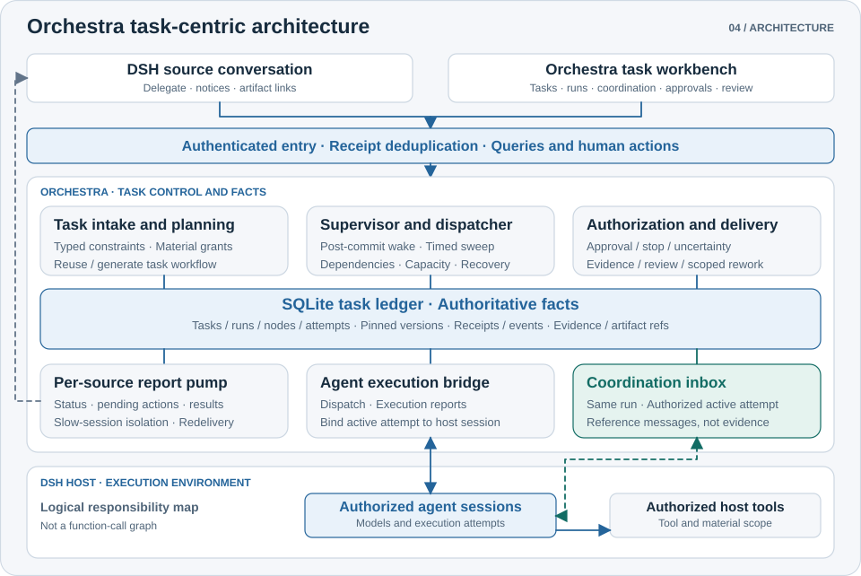

# DSH Orchestra

[简体中文](README.md) · [English](README.en.md)

**From managing agent conversations to managing task workflows.**

> Your conversations will keep growing. Your work should not become harder to manage.

## What happens when you have 1,000 agent conversations?

Can you still tell which conversations belong to the same assignment?

A feature might involve requirements analysis, implementation, testing, and several rounds of fixes, spread across different conversations. Meanwhile, you may be researching another project or preparing documentation. When you return to DSH days or weeks later:

- Which tasks are finished, and which are still open?
- Which execution conversations belong to the same task, and what did each do?
- Where did the work stop, and what needs your attention now?
- Where are the deliverables, and which version should you inspect or revise?

More capable agents let you take on more work. But a list of conversations does not directly answer these questions about tasks. You still have to reconstruct the work from memory and chat history.

**That is why DSH Orchestra exists.**

Orchestra is a task management and workflow orchestration plugin for DeepSeek Harness (DSH). For work routed through Orchestra, it organizes execution steps, associated worker sessions and attempts, progress, pending actions, and deliverables around a task record.

**Conversations are where work happens. Tasks are what you manage.** This distinction matters whether an assignment needs one agent or several.

[Download beta.2](https://github.com/theBeautifulIce/dsh-orchestra/releases/tag/v0.1.0-beta.2) · [Quick start](#quick-start) · [Task coordination](#how-a-task-organizes-collaboration) · [Recorded evidence](#real-desktop-runs-and-evidence) · [Usage](#work-from-your-conversation) · [Issues](https://github.com/theBeautifulIce/dsh-orchestra/issues/new)

## Why Orchestra

### Organize conversations around the work they serve

Imagine developing a plugin while researching a project. Both assignments generate conversations, but what matters is how each assignment is progressing.



*Conceptual illustration. Orchestra organizes tasks it creates or handles and their associated execution records. It does not automatically scan, classify, merge, or migrate every existing DSH conversation.*

| What you need to know | Conversation lists alone | With Orchestra |
| --- | --- | --- |
| What work am I doing? | Reconstruct assignments from chat titles | See work tracked in task records and views |
| Which sessions belong to this assignment? | Remember and find related conversations | Associate task steps with execution sessions and attempts |
| How far has it progressed? | Read messages and infer progress | Inspect task status, step progress, and waiting reasons |
| What needs my attention? | Search chats for pending requests | Inspect required authorization, blocks, or delivery review |
| What if I return later? | Reconstruct context and prior outcomes | Consult retained task records, deliverables, and permitted next actions |
| What was delivered? | Find files and replies across chats | Inspect registered deliverables, provenance, versions, and reviews |

### Task management first, orchestration for more complex work

You do not have to design a complex workflow diagram before handing off an explicit assignment. Start from the original conversation or plan in the panel. Reuse an eligible published workflow or generate a task-specific one when appropriate.

| Capability | Practical value |
| --- | --- |
| **Task management** | Associate execution steps, sessions, and deliverables with the task record. |
| **Progress and lifecycle management** | See task status, queues, attempts, and pending actions rather than infer completion from chat messages. |
| **Workflow and multi-agent coordination** | Plan steps and deliverables, schedule by dependency and capacity, and pass specified upstream results to downstream steps. |
| **Reliable execution and recovery** | Record observed execution facts in the ledger, receipts, events, and evidence; handle interruptions and retries under permitted policies. |
| **Delivery and review** | Register deliverables with provenance and versions, inspect the actual files, and request revisions to a specific version. |

More agents and more elaborate workflows are not goals in themselves. Their value is keeping complex work manageable, inspectable, and deliverable.

Orchestra is for people who use DSH for ongoing work, especially those juggling assignments, checking results across steps, returning to unfinished work, or keeping delivery records. Ordinary questions can remain in native DSH conversations. Only work managed by Orchestra enters its task records. Access, recovery, and available features remain subject to workspace, source-conversation, host, and retention constraints.

## How a task organizes collaboration

Consider an assignment that requires independent research, checks, or cross-validation of a set of materials, followed by a consolidated report with inspectable sources. You delegate **one task**, instead of creating several conversations and coordinating them yourself.



- **Plan the work:** Orchestra plans steps from the goal, constraints, and delivery criteria. Independent steps run as capacity permits; dependent steps wait for specified results.
- **Coordinate within bounds:** Authorized active agent attempts in the same run can request help, reply, share reference handoffs, or report blockers. Messages do not replace deliverables, approvals, or formal verification evidence, and do not independently wake a model to wait for replies.
- **Register deliverables:** Each producing step registers its actual result. Synthesis reads the specified upstream artifacts, not just informal coordination replies. An independent check can continue without becoming an unnecessary dependency.
- **Follow the task:** Return to its task details to inspect progress, attempts, coordination, pending actions, and registered results. Recovery, stopping, and rework follow recorded evidence and authorization.

The pattern applies to research, independent audits, data reconciliation, document preparation, and similar assignments.

### Real Desktop runs and evidence

The diagram is a generic illustration. The following are recorded Desktop runs, with links to actual reports and supporting records.

| Recorded case | Observed behavior | Evidence |
| --- | --- | --- |
| Desktop 1120-B · Independent checks | Income, refunds, and rows were checked separately. The net calculation read two specified upstream reports and returned 180.00; the row check was independent. | [Income](docs/reviews/acceptance/evidence/desktop-1120-b/qa-b-income.md) · [Refunds](docs/reviews/acceptance/evidence/desktop-1120-b/qa-b-refund.md) · [Rows](docs/reviews/acceptance/evidence/desktop-1120-b/qa-b-rows.md) · [Net amount](docs/reviews/acceptance/evidence/desktop-1120-b/qa-b-net.md) · [Run record](docs/reviews/acceptance/dispatch-views.md) |
| S6 T04 · Peer coordination | A requested help, B replied to the same inbox record, and synthesis read two registered artifacts to calculate a net amount of 900. | [Desktop acceptance](docs/reviews/S6-session-desktop-case-matrix.md) · [Focused review](docs/audits/S6-coordination-overhead-independent-audit-round2.md) |
| S6 T02 / T03 / T03B · Lifecycle and approval | A deferred draft resumed after restarting the isolated desktop; another task completed while a named approval was pending. | [Desktop acceptance](docs/reviews/S6-session-desktop-case-matrix.md) |
| S6 T05 / T06 / T09 / T10 · Exceptions | Missing inputs were reported; duplicate requests were deduplicated, unavailable peers settled, cyclic requests rejected, and canceled agents did not restart after reopening Desktop. | [Desktop acceptance](docs/reviews/S6-session-desktop-case-matrix.md) |
| S6 T07 · Complete artifacts | Three reports were registered once each, opened in the DSH native Browser, and a follow-up read only the named artifact. | [Independent review and artifact record](docs/audits/S6-task-session-reliability-independent-audit-round11.md) |

The 1120-B Markdown files can be opened directly. S6 links point to committed acceptance and audit reports; some raw JSON, full sessions, and isolated host data referenced by those reports remain in the local test environment, not public downloads. These runs used DSH Desktop `0.2.2-rc.5` and different frozen candidates; they do not establish revalidation on current HEAD or all models. The coordination-overhead review conditionally passed and recorded inaccurate model narration of one closure reason; formal G6 remains unsigned. There is not enough matched evidence to claim a fixed token or billing reduction.



*Historical Desktop screenshot. The installed version determines the current layout.*

### From request to review



**A task record spans these stages; authorization to execute and acceptance of the result are separate decisions.** Before launch, a draft may be deferred or a plan confirmed. Execution may encounter workflow approval, host tool authorization, blocks, stopping, or recovery. Registered deliverables are checked against the applicable criteria and evidence, and any required human review concerns the exact version. Rework and recovery are allowed only under applicable policy, recorded state, and authorization. Progress notifications and artifact links can reach the source conversation during or after execution, not only at the end.

## Quick start

### Choose a build and install it

**The published prerelease remains `v0.1.0-beta.2`.** This README describes task management and in-development S6 capabilities on `main`, not a guarantee that all these capabilities are included in that package. Consult the tagged README and release notes for the released package. The updater is `1.1.0`.

| Build | How to get it |
| --- | --- |
| Current prerelease `v0.1.0-beta.2` | Download [`dsh-orchestra-0.1.0-beta.2.tgz`](https://github.com/theBeautifulIce/dsh-orchestra/releases/download/v0.1.0-beta.2/dsh-orchestra-0.1.0-beta.2.tgz). The [prerelease page](https://github.com/theBeautifulIce/dsh-orchestra/releases/tag/v0.1.0-beta.2) provides the updater and `SHA256SUMS.txt`; see [this version's README](https://github.com/theBeautifulIce/dsh-orchestra/blob/v0.1.0-beta.2/README.en.md) for usage. |
| Current `main` | Build from source using the [commands below](#development-and-validation), or install a package supplied with its matching commit and SHA-256. |
| Historical `v0.1.0-beta.1` | The [historical release](https://github.com/theBeautifulIce/dsh-orchestra/releases/tag/v0.1.0-beta.1) and [its README](https://github.com/theBeautifulIce/dsh-orchestra/blob/v0.1.0-beta.1/README.en.md) remain available for reference. Use `beta.2` for a new installation. |

### Install into DSH Desktop

**Desktop currently has no plugin-manager file picker for installing a local `.tgz`.** Install local packages with the CLI bundled with that Desktop installation. On first use, open Desktop to initialize its profile, then choose **Quit** from the tray or application menu. Closing the window may only hide it. This follows the [official DSH Desktop instructions](https://github.com/deepseek-ai/deepseek-harness/blob/dsh-v0.2.2-rc.5/apps/desktop/README.md#bundled-command-runtime).

For the current `main`, run `git pull --ff-only origin main` while on your local `main` branch and confirm that it succeeds. With the Node and pnpm versions required by [`package.json`](package.json) available, open PowerShell in the repository root and run:

```powershell
$DshDesktopCommand = 'D:\aboutAI\deepseekharness-desktop\resources\runtime\cli\bin\dsh.cmd'
.\tools\updater\Update-Orchestra.ps1 -Repo (Get-Location).Path -Dsh $DshDesktopCommand
```

Set `$DshDesktopCommand` to the command inside your actual Desktop installation. The updater builds and checks the package, backs up the existing plugin, installs through the official CLI, and compares the installed files with the package. It uses your current local source; it does not pull Git changes. For a custom data directory, add `-DshHome '<absolute path to your DSH_HOME>'`. By default it uses the current `DSH_HOME`, or `.dsh` in your user directory if unset. See the [updater guide](tools/updater/README.md) for other options and the agent entry point.

If you already have a verified `.tgz`, you can install it manually. The following command uses the Desktop CLI selected above. Replace the package path with its actual absolute path and set `$env:DSH_HOME` if your Desktop uses a custom data directory:

```powershell
$OrchestraPackage = 'D:\packages\dsh-orchestra-0.1.0-beta.2.tgz'
& $DshDesktopCommand plugin --profile desktop add $OrchestraPackage
if ($LASTEXITCODE -ne 0) { throw 'Orchestra installation failed. Check the command output.' }
```

The `desktop` profile belongs to that Desktop installation; an npm-global `dsh` cannot replace its bundled CLI. Keep the local package for later dependency installation or recovery. The updater above checks the package contract used by `beta.2` and current `main`. Install historical `beta.1` packages through the official CLI above, and use that tag's README for their features and usage.

After the command succeeds, **reopen Desktop** and select **Orchestra** in the sidebar. If you use the updater, it also checks the installed files. Installation on disk and loading the new code are separate steps. Open a workspace and a normal conversation within it. In **Orchestra → Settings**, check the connection, planner model, worker models, and automatic task routing. The personal adapter enables routing of explicit work requests by default; the planner follows the conversation model unless you choose another configured model. Send a task with clear inputs and a deliverable, then use its task card to follow execution and handle any required action.

The package targets DSH `0.2.2`. Recorded native chat dispatch and approval acceptance used Desktop `0.2.2-rc.5`. Full artifact preview targets its native Browser and compatible hosts. Check the health panel for the capabilities available in your host.

### Try a task with a result you can check

With automatic routing enabled, send this in the workspace conversation. Otherwise, prefix it with your task command, which defaults to `/orchestra `.

```text
Create a task named "Sample net amount". Use only the two simulated receipts of 83.25 and 41.75 and the simulated refund of 15.50 in this message. Calculate the net amount to two decimal places. Deliver a new file named orchestra-sample-net.md containing the inputs, calculation, and result. Do not read or modify existing files, tasks, or workflows.
```

Look for the Orchestra receipt. The expected result is **109.50**. Open the registered file in **Tasks → this run → Results**, or use the artifact name in the source conversation on a current build. Ask about the named task in the same conversation to check its status.

## Work from your conversation

### Start, follow, and revise

- **Start from chat.** Provide the goal, permitted materials, deliverables, and acceptance criteria. The task command explicitly routes one request even when automatic routing is off. Ordinary questions remain in the DSH conversation.
- **Plan from the panel.** Open **Tasks → Plan with natural language** to inspect a plan before launch. For repeat work, start from an eligible published workflow. Workflow drafts support validation and rehearsal before publishing; an active run keeps its pinned version.
- **Follow the handoffs.** The board, workflow, queue, and list expose different parts of the same task. Open a step for its model, reasoning effort, attempts, timing, and evidence.
- **Review a version.** In **Results → Delivery review and rework**, read the deliverable and submit specific feedback. A held or revised result can also send a review notice to the originating conversation. Accepting a revised version settles its applicable review hold.
- **Inspect a problem before retrying.** Long runs, blocks, and repeated qualifying rework can trigger diagnosis; escalation requires evidence and a stronger approved model. See [rework design](docs/design/rework-orchestration.md) and [verified-retry acceptance](docs/reviews/acceptance/f8-plugin-only-2026-11-21.md).



*Historical acceptance screenshot of registered results and review actions. The current A workbench can differ in layout.*

### Open the complete deliverable

Current builds keep named artifact links alongside the summary in the source conversation. A normal final reply or later message does not hide them. Open a name in **DSH Desktop's built-in browser**, or choose **Download original** on the conversation card. Each action checks the source conversation and the exact artifact version.

| Content | How to read it |
| --- | --- |
| Supported UTF-8 text, including Markdown, TXT, JSON, and CSV | Complete browser view; Markdown above 256 KiB uses complete plain text |
| PNG, JPEG, GIF, WebP | Image preview in the native Browser |
| HTML and SVG | Source text without script execution or automatic remote-image loading |
| PDF, Office, and files with other extensions | **Download original** from the conversation card |

The existing 8 MiB artifact limit applies. The native Desktop Browser is supported; the Web iframe fallback is outside this preview's scope. If a reader link expires or DSH restarts, click the same artifact name again. Older messages without artifact cards can obtain them through a task-status query in the original conversation. Expired retention or an unavailable version returns a reason instead of silently substituting a different file.

### Configure the task once, keep its context together

| Setting or context | What it controls |
| --- | --- |
| Task command | Defaults to `/orchestra`; rename it per Desktop profile. Checks run after input and again before saving against public host commands, user-invocable skills, and client commands. Only the saved name remains active. |
| Execution permissions | Defaults to all host permissions. Other modes use source-session inheritance, planner approval, or user approval. Host authorization, task scope, and node tool restrictions remain the upper bound; a new setting applies to future attempts. |
| Models and capacity | Configure five worker complexity levels, model ceilings and supported reasoning effort, session capacity, run parallelism, and step/helper limits. |
| Planning and execution limits | Set the applicable time budgets and inspect the reason when a stage exceeds them. |
| Project context | Put goals, important locations, and rules in a plain UTF-8 `ORCHESTRA.md` at the authorized workspace root. Prioritize the first 120 lines and 4 KiB; a run pins its snapshot at first dispatch. |
| Task context and notes | Steps receive their requirements and applicable upstream artifacts. Scoped notes preserve operational information during the run. |

Reopen the task-command settings after enabling or disabling plugins. DSH does not expose every third-party input rule, so rules outside its public command catalogs cannot all be checked.

Ordinary execution nodes run only native tools confirmed to be read-only.

The current main-branch personal Desktop adapter supports local task routing, execution, and bounded same-run coordination for eligible authorized attempts. Independent cross-run checks, durable memory writes, shared trial rings, and the QQ on-call connector still require trusted host integration. Supported deferred drafts are isolated by source conversation and have a 30-minute checkpoint lifetime; recovery follows host state, recorded facts, and authorization. When memory is wired, **Organize as memory** requires review and approval of the proposal, source, and scope. Project context and task notes work independently of durable memory.

### If a task needs attention

| What you see | Next step |
| --- | --- |
| A chat answer with no Orchestra receipt | Check automatic routing and the current task command in a normal workspace conversation. |
| A step is waiting | Check the queue for capacity, upstream dependencies, or human action; open the step for details. |
| Planning times out or a level has no candidate model | Check model availability, capability settings, and planning limits. |
| DSH closes or the computer sleeps | Reopen DSH, inspect the original run and recovery actions, then proceed from recorded facts. Local execution depends on the running host. |

## Architecture

**DSH supplies conversations and the execution environment; Orchestra organizes tasks, supervises runs, and manages delivery.** The task management layer does not replace the host's conversation system. The source conversation and workbench reach the same task records through authenticated entry points.



| Layer | Responsibility and boundary |
| --- | --- |
| Intake, planning, and admission | Bind the source and materials, interpret and validate typed requirements, reuse a suitable pinned workflow or generate a task-specific one. Receipts and pinned versions help avoid treating a repeat request as a new assignment. |
| Supervisor and dispatcher | Merge in-process wakeups after committed SQLite transactions; timed scans provide fallback. The supervisor drives existing scheduling and maintenance; the dispatcher remains the sole owner of dispatch. |
| Authoritative ledger and artifact storage | The service is SQLite's sole writer and records tasks, runs, node attempts, versions, receipts, events, evidence, and artifact references. Existing contracts govern state, authorization, review, and recovery. |
| DSH execution bridge | Bind active authorized attempts to host sessions and permitted tools; execution reports enter the existing service and evidence chain. |
| Bounded coordination inbox | Authorized active attempts in the same run exchange reference messages. Duplicate requests are deduplicated, cycles rejected, and expired, unavailable, or canceled requests settled. The inbox does not dispatch, rewrite workflows, grant authority, or approve results. |
| Independent source-report pump and workbench | Isolate notifications, acknowledgments, and redelivery by source conversation. Task status, pending human actions, and exact artifact versions are queryable; one slow conversation does not stall others. |

This is a logical responsibility map, not a function-call graph. Reference messages and formal deliverables have distinct recording and authorization boundaries. A post-commit wakeup is not a durable delivery acknowledgment. Recovery and retry follow recorded facts; external exactly-once effects are not guaranteed.

Implementation and evidence: [Task supervisor](src/service/task-supervisor.ts) · [Coordination inbox](src/service/run-coordination.ts) · [Source report pump](src/service/chat-report-pump.ts) · [Task planning](src/service/task-planning.ts) · [Supervisor and coordination design](docs/implementation/task-supervisor-coordination.md) · [Desktop acceptance](docs/reviews/S6-session-desktop-case-matrix.md).

Custom hosts use `serveDshOrchestra` to integrate execution, models, and tools, `resolveHttpHuman` to authenticate human actions, and `orchestraPanelTransport` to connect the panel. See [design notes](docs/design-notes.md), [operations and rollback](docs/runbook.md), and [trial circles](docs/trial-circles.md).

## Development and validation

Use the Node and pnpm versions declared in [`package.json`](package.json). From the repository root, run:

```powershell
pnpm install --frozen-lockfile
pnpm typecheck
pnpm exec vitest run --reporter=dot --maxWorkers=2
pnpm build
New-Item -ItemType Directory -Force .tmp/packages | Out-Null
pnpm pack --pack-destination .tmp/packages
```

Install the resulting `.tgz` in the intended profile using the [Desktop installation steps above](#install-into-dsh-desktop), then reopen Desktop. Pulling source changes does not update an already installed plugin. For a self-managed web profile, use `dsh plugin --profile web add <absolute-path-to-tgz>` and configure the authenticated host transport and permissions.

| Path | Responsibility |
| --- | --- |
| [`src/index.ts`](src/index.ts), [`src/service`](src/service/) | Host wiring, planning, workflow versions, scheduling, commands, results |
| [`src/executor`](src/executor/) | DSH execution bridge, model routing, tools, reports |
| [`src/core`](src/core/), [`src/infra`](src/infra/) | Workflow rules, state, evidence, SQLite ledger |
| [`src/client`](src/client/) | Native chat views and the Orchestra workbench |
| [`tests`](tests/), [acceptance index](docs/reviews/acceptance/README.md) | Unit, contract, integration, UI tests and recorded acceptance evidence |

Acceptance records identify the candidate they tested. The [Desktop record](docs/reviews/acceptance/desktop.md), targeted checks, and short observation windows do not replace the formal 24-hour soak or 72-hour R0 observation. Release status follows the evidence for the same frozen candidate.

## License

Source is available for purposes permitted by the [PolyForm Noncommercial License 1.0.0](LICENSE). Commercial use requires separate authorization from the rights holder. DSH, dependencies, and model providers have their own terms. [Official PolyForm terms](https://polyformproject.org/licenses/noncommercial/1.0.0).

## Issues and ideas welcome

**Have a task you want Orchestra to handle better? We welcome your feedback.**

[Open an Issue](https://github.com/theBeautifulIce/dsh-orchestra/issues/new) · [Browse existing Issues](https://github.com/theBeautifulIce/dsh-orchestra/issues)

- **Bug reports:** include the DSH and plugin version or commit, operating system, reproduction steps, expected and actual behavior, and a relevant redacted log or screenshot.
- **Feature requests:** describe the task, the step that gets in your way, and the outcome you want.
- **Usability and documentation:** tell us which page, message, diagram, or instruction was unclear and what you expected to find.

Please remove credentials and private task material before posting. Concrete examples help us improve how work moves from the first request to a usable deliverable.
