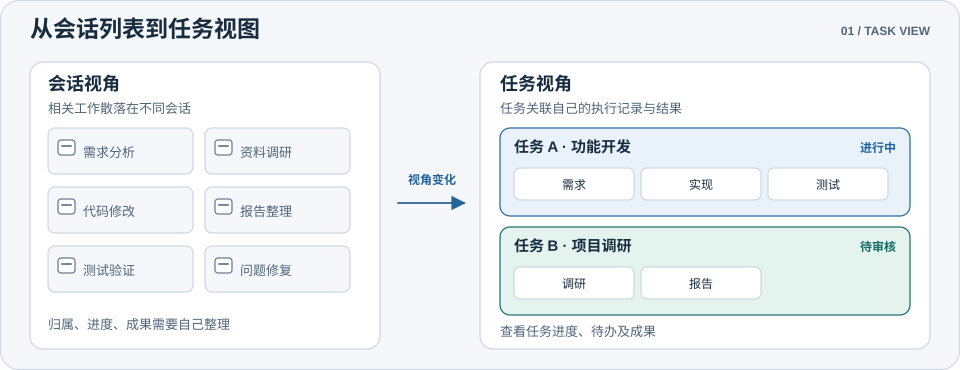
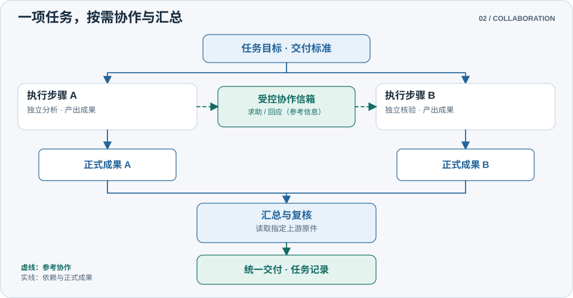
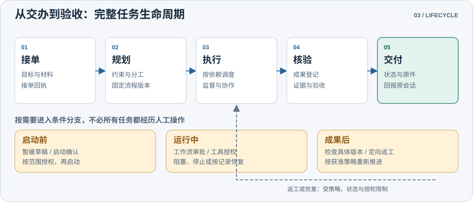
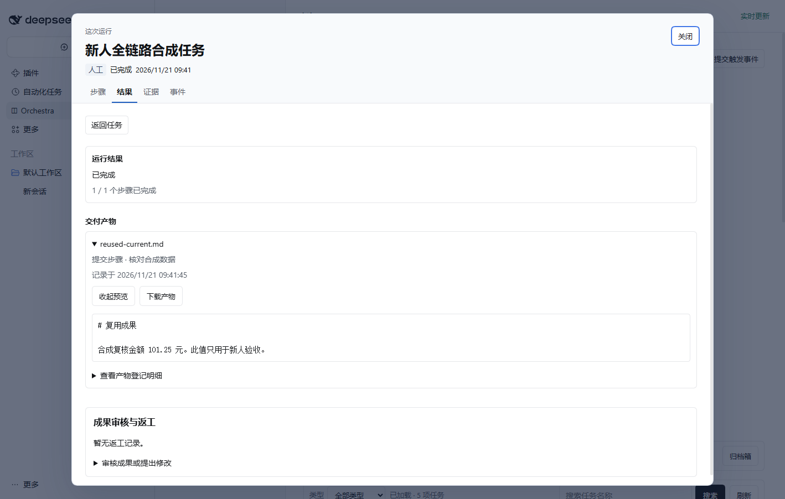
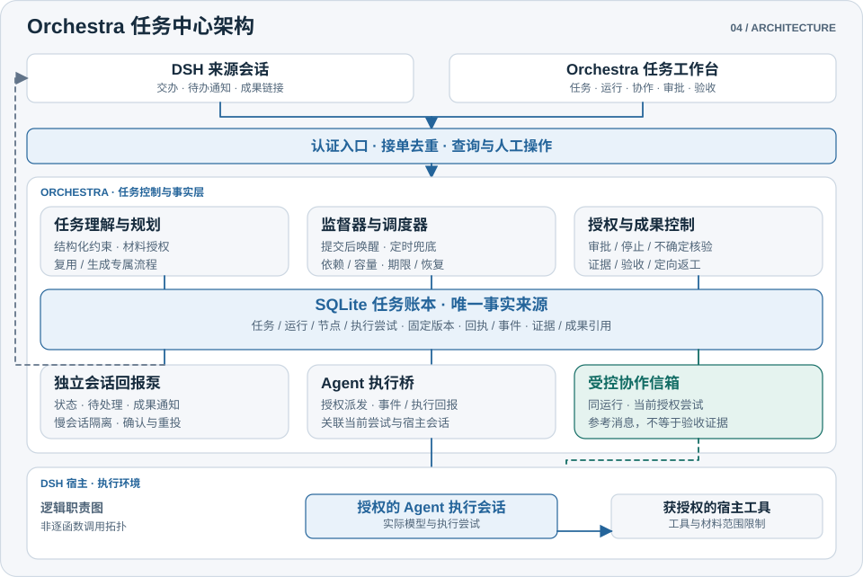

# DSH Orchestra

[简体中文](README.md) · [English](README.en.md)

**从 Agent 的会话管理，迈向任务流程管理。**

> 会话会越来越多，工作不应该越来越乱。

## 如果你已经有 1000 个 Agent 会话

你还能说清楚，哪些会话属于同一个任务吗？

一次功能开发可能经历需求分析、代码修改、测试和几轮修复，分散在不同的会话里。与此同时，你还在做项目调研、整理文档、处理其他问题。几天甚至几周以后，当你重新打开 DSH：

- 哪些工作已经完成，哪些还没有做完？
- 同一件事开过多少个执行会话，各自负责什么？
- 上次做到哪一步，为什么停在那里，现在需要你做什么？
- 最终成果在哪里，哪一版才是需要检查或继续修改的版本？

Agent 越强大，能交办的工作就越多。但一个按会话排列的列表，并不能直接回答这些关于任务的问题。你仍然要靠记忆和翻阅聊天记录，把分散的工作重新拼起来。

**这就是 DSH Orchestra 诞生的原因。**

Orchestra 是 DeepSeek Harness（DSH）的任务管理与工作流编排插件。它让由 Orchestra 接管的工作拥有自己的任务记录，将执行步骤、相关执行会话与尝试、进度、待处理事项和交付成果组织起来。

**会话是工作的执行载体，任务才是工作的管理对象。** 不论一次工作只需要一个 Agent，还是需要多个 Agent 分工，管理任务的价值都成立。

[下载 beta.2 预发行版](https://github.com/theBeautifulIce/dsh-orchestra/releases/tag/v0.1.0-beta.2) · [快速开始](#快速开始) · [任务协作示例](#一项任务如何组织协作) · [实机验收](#真实运行与证据) · [使用指南](#从会话交办到成果验收) · [提交 Issue](https://github.com/theBeautifulIce/dsh-orchestra/issues/new)

## 为什么用 Orchestra

### 从一堆会话，变成一件件有记录的工作

假设你同时在做插件开发和项目调研。执行过程中会产生多个会话，但你关心的是这两件工作各自进展如何，而不是某个会话又增加了多少条消息。



*这是管理方式的概念示意：Orchestra 组织的是其创建或接管的任务及相关执行记录，并非扫描全部已有 DSH 历史会话后自动分类、合并或迁移。*

| 你关心的问题 | 仅依靠会话列表 | 使用 Orchestra |
| --- | --- | --- |
| 我在做哪些事？ | 从多个聊天标题中回忆工作内容 | 通过任务记录和任务视图查看已纳入管理的工作 |
| 哪些执行会话属于这件事？ | 自己回忆和查找相关对话 | 将任务的执行步骤、会话与执行尝试关联起来 |
| 任务做到哪了？ | 阅读消息后自行判断 | 查看任务状态、步骤进度及等待原因 |
| 现在需要我做什么？ | 在聊天中寻找尚未处理的请求 | 在任务记录中查看需要处理的授权、阻塞或成果审核 |
| 隔一段时间回来怎么办？ | 重新梳理上下文和之前的处理结果 | 从仍保留的任务记录、成果及允许的后续操作了解进展 |
| 做完之后交付了什么？ | 在多个会话中寻找文件和回复 | 查看已登记的交付物、来源、版本和审核结果 |

### 任务管理是基础，工作流编排让复杂任务更容易管理

Orchestra 并不是要求你先设计一张复杂的流程图，才能开始使用 Agent。对明确的任务，可以从原会话交办目标，也可以先在面板规划；有符合条件的已发布工作流时可以复用，没有合适的流程时可以生成任务专属流程。

随着任务变复杂，Orchestra 在同一个任务的生命周期中提供进一步的能力：

| 能力 | 对日常工作的价值 |
| --- | --- |
| **任务化管理** | 从交办目标开始建立任务记录，关联执行步骤、执行会话和成果。 |
| **进度与生命周期管理** | 从任务卡查看状态、队列、执行尝试及待处理事项，避免仅凭聊天消息猜测任务是否完成。 |
| **工作流与多 Agent 协作** | 主脑规划步骤与交付要求；调度器按依赖和容量组织执行，汇总步骤接收指定上游成果。 |
| **可靠执行与恢复** | 通过账本、回执、事件和证据记录已观察到的执行事实，按允许的策略处理中断、失败及重试。 |
| **成果交付与验收** | 登记成果及其来源、版本，在原会话和工作台中检查实际文件，并将具体版本交回修改。 |

工作流不是为了让任务看起来更复杂，多个 Agent 也不是目的。它们的价值在于，让复杂工作依然能够像一件普通任务那样被跟踪、检查和交付。

Orchestra 适用于长期使用 DSH 处理工作的人，尤其是同时推进多项工作、需要跨步骤核对结果、经常回到未完成任务、或需要保留交付记录的用户。普通问答仍可直接使用 DSH 原生会话；只有交由 Orchestra 管理的工作才纳入其任务记录。任务访问、恢复和可用功能仍受工作区、来源会话、宿主能力及保留策略等约束。

## 一项任务如何组织协作

以一项需要多个独立分析结果的工作为例：你希望对一批材料进行调研、分项检查或交叉核对，最后拿到可以检查来源的综合报告。你交办的是**一件工作**，而不是提前创建几个执行会话再手动协调。



- **拆解任务：** Orchestra 根据目标、约束与交付要求规划步骤；能独立开展的工作按容量并行，需要依赖的步骤等待指定成果。
- **受控协作：** 同一运行中符合权限与当前执行尝试条件的 Agent 可以求助、回应、交接参考信息或上报阻塞。消息不会替代成果、审批或正式核验证据，也不会为了等待回复额外唤醒模型。
- **正式交付：** 每个步骤登记自己的实际成果；汇总步骤读取指定上游原件，而非把协作回复当成已验证的结论。独立检查可以继续进行，不必强制成为汇总步骤的前置依赖。
- **任务跟进：** 回到任务详情，可以查看进度、执行尝试、协作记录、待处理事项与已登记的成果；出现问题时，按授权和证据决定恢复、停止或返工。

这个模式不局限于某种业务。项目调研、分项审计、数据核对、文档编制等，都可以组织成同一个任务中的分工、正式交接与成果审核。

### 真实运行与证据

图中是通用模式；以下是仓库中已经记录的实机案例，可以直接核对原件和报告，而不是把示意图当成测试结果。

| 实机案例 | 已记录的实际行为 | 查看证据 |
| --- | --- | --- |
| Desktop 1120-B · 并行核对 | 收入、退款、行数分别核对；净额步骤读取两份指定上游报告，得到 180.00，行数核验独立完成。 | [收入原件](docs/reviews/acceptance/evidence/desktop-1120-b/qa-b-income.md) · [退款原件](docs/reviews/acceptance/evidence/desktop-1120-b/qa-b-refund.md) · [行数原件](docs/reviews/acceptance/evidence/desktop-1120-b/qa-b-rows.md) · [净额原件](docs/reviews/acceptance/evidence/desktop-1120-b/qa-b-net.md) · [运行记录](docs/reviews/acceptance/dispatch-views.md) |
| S6 T04 · 同行协作 | A 发起求助，B 对同一信箱记录回应；汇总步骤读取两份正式原件，复算净额 900。 | [桌面验收记录](docs/reviews/S6-session-desktop-case-matrix.md) · [专项复核](docs/audits/S6-coordination-overhead-independent-audit-round2.md) |
| S6 T02 / T03 / T03B · 生命周期与审批 | 暂缓草稿在重开隔离桌面后续接；具名审批等待期间另一项任务继续并交付。 | [桌面验收记录](docs/reviews/S6-session-desktop-case-matrix.md) |
| S6 T05 / T06 / T09 / T10 · 异常处理 | 缺材料时报告缺口；重复请求去重、无人回复收口、循环求助拒绝；停止后重启未重复启动旧代理。 | [桌面验收记录](docs/reviews/S6-session-desktop-case-matrix.md) |
| S6 T07 · 完整成果 | 三份报告各登记一次，在 DSH 内置浏览器打开，点名追问只读取指定原件。 | [独立复审与原件记录](docs/audits/S6-task-session-reliability-independent-audit-round11.md) |

1120-B 的 Markdown 原件可直接在线打开。S6 链接为提交到仓库的实机报告与审计记录，报告中引用的部分原始 JSON、完整会话和隔离宿主数据保存在本机验收环境，不是公开下载文件。各项测试使用不同冻结候选及 DSH Desktop `0.2.2-rc.5`，不代表全部场景已在当前 HEAD 或所有模型上重新验收。协作开销专项有条件通过，记录来源模型转述关闭原因不准确的问题；正式 G6 尚未签署。目前也没有足够同条件样本证明固定的 Token 或账单降幅。


*历史实机截图；当前工作台界面以安装版本为准。*

### 从交办到验收



**任务记录贯穿各个阶段，执行授权与成果验收是不同的决策。** 启动前可以暂缓或确认计划；运行中可能出现工作流人工审批、宿主工具授权、阻塞、停止或恢复操作；成果登记后按实际交付标准和证据核验，需要人工审核时检查具体版本。只有符合既有策略、状态及授权的工作才可以重新推进。状态通知、阶段回报与成果链接可在任务执行期间或结束时送回来源会话，不必等所有步骤完成才首次回报。

## 快速开始

### 选择版本并安装

**已发布预发行版仍为 `v0.1.0-beta.2`。** 本 README 描述当前 `main` 的任务管理与 S6 开发中能力，并不表示这些新能力已包含在预发行安装包中。预发行版的功能与用法以对应标签 README 和发布说明为准。更新器为 `1.1.0`。

| 版本 | 获取方式 |
| --- | --- |
| 当前预发行 `v0.1.0-beta.2` | 下载 [`dsh-orchestra-0.1.0-beta.2.tgz`](https://github.com/theBeautifulIce/dsh-orchestra/releases/download/v0.1.0-beta.2/dsh-orchestra-0.1.0-beta.2.tgz)。[预发行页](https://github.com/theBeautifulIce/dsh-orchestra/releases/tag/v0.1.0-beta.2)提供更新工具和 `SHA256SUMS.txt`；用法见[该版本的 README](https://github.com/theBeautifulIce/dsh-orchestra/blob/v0.1.0-beta.2/README.md)。 |
| 当前 `main` | 按[源码构建命令](#开发与验证)生成安装包，或使用同时提供对应提交和 SHA-256 的构建包。 |
| 历史 `v0.1.0-beta.1` | 保留[历史发布页](https://github.com/theBeautifulIce/dsh-orchestra/releases/tag/v0.1.0-beta.1)及[对应 README](https://github.com/theBeautifulIce/dsh-orchestra/blob/v0.1.0-beta.1/README.md)，便于核对旧版本。新安装建议使用 `beta.2`。 |

### 安装到 DSH Desktop

**当前 Desktop 没有从插件管理页面选择本地 `.tgz` 安装的入口。** 本地安装包通过该 Desktop 自带的 CLI 安装。首次使用时先打开 Desktop 完成初始化，然后从托盘或应用菜单选择**退出**；窗口右上角的 × 可能只是隐藏窗口。安装方式依据 [DSH Desktop 官方说明](https://github.com/deepseek-ai/deepseek-harness/blob/dsh-v0.2.2-rc.5/apps/desktop/README.md#bundled-command-runtime)。

使用当前 `main` 时，先在本地 `main` 执行 `git pull --ff-only origin main`，确认拉取成功。准备好 [`package.json`](package.json) 要求的 Node 和 pnpm 后，在仓库根目录打开 PowerShell，执行：

```powershell
$DshDesktopCommand = 'D:\aboutAI\deepseekharness-desktop\resources\runtime\cli\bin\dsh.cmd'
.\tools\updater\Update-Orchestra.ps1 -Repo (Get-Location).Path -Dsh $DshDesktopCommand
```

将 `$DshDesktopCommand` 改为实际 Desktop 安装下的命令路径。工具会构建、打包、校验安装包、备份现有插件，并通过官方 CLI 安装后逐文件核对。它更新的是当前本地源码，不会替你拉取 Git。使用自定义数据目录时，另传 `-DshHome '<实际 DSH_HOME 绝对路径>'`；默认使用当前 `DSH_HOME`，未设置时为用户目录下的 `.dsh`。其他参数及智能体入口见[更新工具说明](tools/updater/README.md)。

已经取得并核对过 `.tgz` 时，也可以手动安装。以下命令使用上面指定的 Desktop CLI；将包路径改为实际绝对路径，并在自定义数据目录下设置对应的 `$env:DSH_HOME`：

```powershell
$OrchestraPackage = 'D:\packages\dsh-orchestra-0.1.0-beta.2.tgz'
& $DshDesktopCommand plugin --profile desktop add $OrchestraPackage
if ($LASTEXITCODE -ne 0) { throw 'Orchestra 安装失败，请查看命令输出。' }
```

Desktop 的 `desktop` 配置由该安装管理，不能用 npm 全局 `dsh` 代替它自带的 CLI。保留本地安装包，供后续依赖安装和恢复使用。上面的更新工具适用于 `beta.2` 和当前 `main` 的包契约；历史 `beta.1` 请通过上述官方 CLI 安装，功能与用法以对应标签说明为准。

命令成功后，**重新打开 Desktop**，从侧栏进入 **Orchestra**；使用更新工具时，它还会核对实际安装文件。磁盘安装完成与宿主加载新代码是两个步骤。打开工作区及其中的普通会话，在 **Orchestra → 设置**检查连接、主脑模型、子智能体模型和聊天任务自动接管。个人适配器默认接管明确任务；主脑默认跟随会话模型，也可指定已配置的模型。随后发送输入明确、交付要求具体的任务，从任务卡跟进执行并处理必要事项。

插件面向 DSH `0.2.2` 系列。已记录的原生会话派单与审批验收使用 Desktop `0.2.2-rc.5`；完整成果预览面向该版本的原生 Browser 及兼容宿主。本机可用能力以健康页显示为准。

### 试一条结果可核对的任务

开启自动接管后，在工作区会话直接发送以下内容；否则在前面加上当前任务指令，默认为 `/orchestra `。

```text
请完成一项名为「模拟款项核对」的任务。使用我在这条消息提供的两笔模拟收入 83.25、41.75 和一笔模拟退款 15.50，核算净额，保留两位小数。交付本任务专用的 orchestra-sample-net.md，写明输入、算式和结果。不读取或修改已有文件、任务和流程。
```

收到 Orchestra 接单回执后，可在 **任务 → 本次运行 → 结果**打开已登记文件；当前构建也可直接点击原会话中的成果名称。预期净额为 **109.50**。在同一会话点名询问这个任务，即可查询状态。

## 从会话交办到成果验收

同一件工作的目标、执行状态与交付物应有可查的任务记录。以下操作围绕 Orchestra 接管的任务进行；恢复操作以实际保留记录及宿主状态为准。

### 交办、跟进与修改

- **从会话交办。** 写明目标、允许使用的材料、交付物与验收标准。任务指令可显式派单，关闭自动接管后仍然有效。普通问答继续使用 DSH 会话。
- **从面板规划。** 在 **任务 → 用自然语言规划**先查看计划再启动。重复性工作可选符合条件的已发布流程；草稿支持校验和演练，在途任务保留已固定的流程版本。
- **跟进步骤交接。** 看板、流程、队列和列表展示同一任务的不同信息。打开步骤可查看实际模型、思考强度、执行尝试、耗时和证据。
- **验收具体版本。** 在 **结果 → 交付审核与返工**阅读成果并提交具体意见。留验或修订结果也可向来源会话发出审核通知；接受修订版本后，解除适用的留验状态。
- **依据问题处理执行。** 长时间运行、阻塞和符合条件的反复返工可触发诊断。模型升级需要证据支持和获准的更强模型，详见[返工设计](docs/design/rework-orchestration.md)与[核验后重试记录](docs/reviews/acceptance/f8-plugin-only-2026-11-21.md)。



*历史成果验收截图，用于展示登记成果和审核操作；界面布局以当前 A 版工作台为准。*

### 打开完整成果

当前构建在原会话的摘要旁保留具名成果链接，普通最终回复和后续消息不会隐藏这些入口。点击名称可在 **DSH Desktop 内置浏览器**中打开，也可在会话卡片选择**下载原件**。打开与下载都会核对来源会话和成果的具体版本。

| 内容 | 阅读方式 |
| --- | --- |
| 支持的 UTF-8 文本：Markdown、TXT、JSON、CSV 等 | 浏览器内查看完整内容；超过 256 KiB 的 Markdown 以完整纯文本显示 |
| PNG、JPEG、GIF、WebP | 原生 Browser 内预览图片 |
| HTML、SVG | 查看源码，不执行脚本或自动加载远程图片 |
| PDF、Office 及其他扩展名的文件 | 在会话卡片选择**下载原件** |

成果仍受现有 8 MiB 上限约束。此预览支持原生 Desktop Browser；Web iframe 回退不在支持范围内。阅读链接过期或 DSH 重启后，重新点击同一成果名称即可获取新链接。旧消息缺少成果卡片时，可在原会话查询任务状态。超过保留期或版本不可用时会说明原因。

### 配置任务，保留上下文

| 设置或资料 | 作用 |
| --- | --- |
| 任务指令 | 默认 `/orchestra`，可按 Desktop 用户配置修改。输入后及保存前，对照宿主公开命令、用户可调用技能和客户端命令检查冲突；仅已保存的名称生效。 |
| 执行权限 | 默认全部宿主权限，也可跟随来源会话、由主脑审批或由用户审批。宿主授权、任务范围与节点工具限制仍然有效；修改设置适用于后续执行尝试。 |
| 模型与容量 | 配置五档子智能体模型、能力上限和支持的思考强度，以及会话容量、流程并发和节点／助手上限。 |
| 规划与执行时限 | 设置相应阶段的时间预算，超时后查看具体原因。 |
| 项目资料 | 在获授权工作区根目录放置 UTF-8 纯文本 `ORCHESTRA.md`，写明目标、重要位置和规则。优先安排前 120 行、4 KiB 内的内容；运行在首次派发时固定其快照。 |
| 任务资料与便条 | 步骤接收本次要求和适用的上游成果，限域便条保留运行中的操作信息。 |

启用或停用其他插件后，可重新打开任务指令设置检查。DSH 未公开所有第三方输入规则，公开命令目录之外的规则无法全部核验。

普通执行节点只执行已确认的只读原生工具。

当前主线的个人 Desktop 适配器支持本机任务接管与执行，以及同一次运行内、符合权限条件的受控协作信箱。跨运行独立核验、长期记忆写入、共享试用圈和 QQ 值班连接仍需可信宿主额外接入。受支持的暂缓草稿按来源会话隔离，检查点有效期为 30 分钟；实际恢复受宿主状态、任务记录和授权约束。接入记忆服务后，**整理为记忆**仍需核对提案、来源和作用域后批准；项目资料与任务便条可独立使用。

### 任务需要处理时

| 看到的情况 | 下一步 |
| --- | --- |
| 只有聊天回复，没有 Orchestra 接单回执 | 在工作区普通会话检查自动接管与当前任务指令。 |
| 步骤正在等待 | 从队列确认是在等名额、等上游还是等人工，再打开步骤查看详情。 |
| 规划超时，或某档没有可用模型 | 检查模型可用性、能力设置与规划时限。 |
| DSH 关闭或电脑休眠 | 重新打开后检查原任务和恢复操作，再根据记录处理。本机执行依赖宿主持续运行。 |

## 架构

**DSH 提供会话和执行环境，Orchestra 组织任务、监督运行并管理交付。** 任务管理层不是宿主聊天系统的替代品。原会话和工作台通过认证入口连接同一套任务记录。



| 层次 | 职责与边界 |
| --- | --- |
| 任务理解、规划和准入 | 绑定来源与材料，解释并校验结构化要求，复用合适的固定流程或生成任务专属流程；接单回执和固定版本避免把同一请求误作新任务。 |
| 任务监督器与调度器 | SQLite 事务提交后触发进程内合并唤醒，定时扫描兜底；监督器驱动既有调度与维护，调度器仍是派发的唯一负责方。 |
| 权威账本与成果存储 | 服务是 SQLite 唯一写入者，持久化任务、运行、节点尝试、版本、回执、事件、证据和成果引用。状态、权限、验收及恢复依既有契约收口。 |
| DSH 执行桥 | 绑定当前授权尝试、宿主会话与获准工具，执行回报进入既有服务与证据链。 |
| 受控协作信箱 | 同一运行内当前授权尝试可交换参考信息；重复消息去重、循环求助拒绝、到期/失联/取消收口。不自主派发、修改流程、扩大权限或签认结果。 |
| 独立会话回报泵与工作台 | 按来源会话隔离回报、确认和重投；任务状态、人工待办、具体成果版本可查询，慢会话不会阻塞其他会话回报。 |

这是一张逻辑职责图，并非逐函数调用拓扑。参考消息与正式成果经过不同的记录和授权边界；账本提交后的唤醒提示也不是持久投递确认。实际恢复和重试依据记录事实，不保证外部副作用恰好一次。

实现与证据：[任务监督器](src/service/task-supervisor.ts) · [协作信箱](src/service/run-coordination.ts) · [独立回报泵](src/service/chat-report-pump.ts) · [任务规划](src/service/task-planning.ts) · [监督器与代理协作设计](docs/implementation/task-supervisor-coordination.md) · [实机验收记录](docs/reviews/S6-session-desktop-case-matrix.md)。

自建宿主通过 `serveDshOrchestra` 接入执行、模型和工具服务，通过 `resolveHttpHuman` 验证人工操作身份，并用 `orchestraPanelTransport` 连接面板。详见[设计说明](docs/design-notes.md)、[运维与回滚手册](docs/runbook.md)及[试用圈指南](docs/trial-circles.md)。

## 开发与验证

使用 [`package.json`](package.json) 声明的 Node 和 pnpm 版本，在仓库根目录执行：

```powershell
pnpm install --frozen-lockfile
pnpm typecheck
pnpm exec vitest run --reporter=dot --maxWorkers=2
pnpm build
New-Item -ItemType Directory -Force .tmp/packages | Out-Null
pnpm pack --pack-destination .tmp/packages
```

将生成的 `.tgz` 按上方[Desktop 安装步骤](#安装到-dsh-desktop)安装到目标用户配置，并重新打开 Desktop。拉取源码不会自动更新已经安装的插件。自建 Web 宿主可使用 `dsh plugin --profile web add <安装包绝对路径>`，并配置经过认证的宿主传输和权限。

| 目录 | 职责 |
| --- | --- |
| [`src/index.ts`](src/index.ts)、[`src/service`](src/service/) | 宿主接入、规划、流程版本、调度、命令与成果 |
| [`src/executor`](src/executor/) | DSH 执行桥、模型路由、工具与回报 |
| [`src/core`](src/core/)、[`src/infra`](src/infra/) | 流程规则、状态、证据与 SQLite 账本 |
| [`src/client`](src/client/) | 原生会话界面和 Orchestra 工作台 |
| [`tests`](tests/)、[验收索引](docs/reviews/acceptance/README.md) | 单元、契约、集成、界面测试与已记录的验收证据 |

验收记录注明各自验证的候选版本。[Desktop 记录](docs/reviews/acceptance/desktop.md)、定向检查和短时观察不能替代正式的 24 小时浸泡或 72 小时 R0 观察；发布状态以同一冻结候选的证据为准。

## 许可证

源码按 [PolyForm Noncommercial License 1.0.0](LICENSE) 允许的用途提供，商业使用需另行取得权利人的授权。DSH、依赖和模型服务各有其使用条款。[PolyForm 官方条款](https://polyformproject.org/licenses/noncommercial/1.0.0)。

## 欢迎提 Issue

**你的 Agent 会话越来越多之后，遇到了哪些难以管理的任务？欢迎告诉我们。**

[提交 Issue](https://github.com/theBeautifulIce/dsh-orchestra/issues/new) · [查看已有 Issues](https://github.com/theBeautifulIce/dsh-orchestra/issues)

- **发现 Bug：** 请提供 DSH 与插件版本或提交号、操作系统、复现步骤、预期和实际结果，以及相关的脱敏日志或截图。
- **提出功能建议：** 说说你要完成什么任务、哪一步不顺，以及希望得到什么结果。
- **改进体验或文档：** 指出哪处页面、提示、图或说明不清楚，以及你原本期待看到什么。

提交前请移除凭据和私人任务材料。具体的使用案例能帮助我们把从交办到交付的每一步做得更好。
