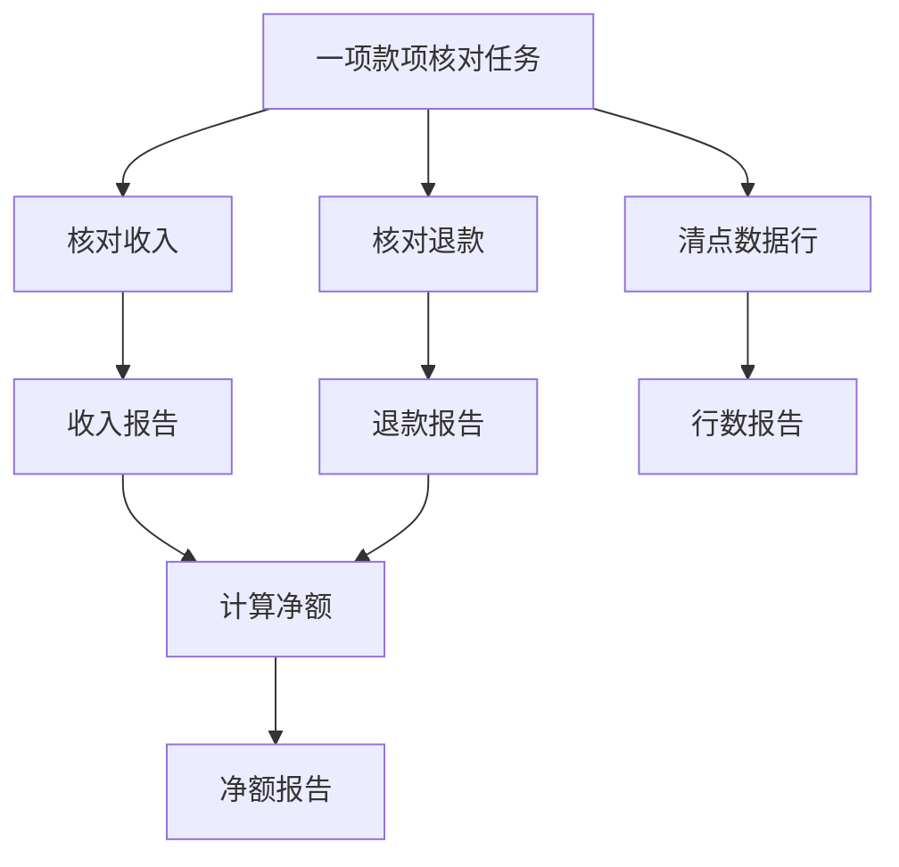
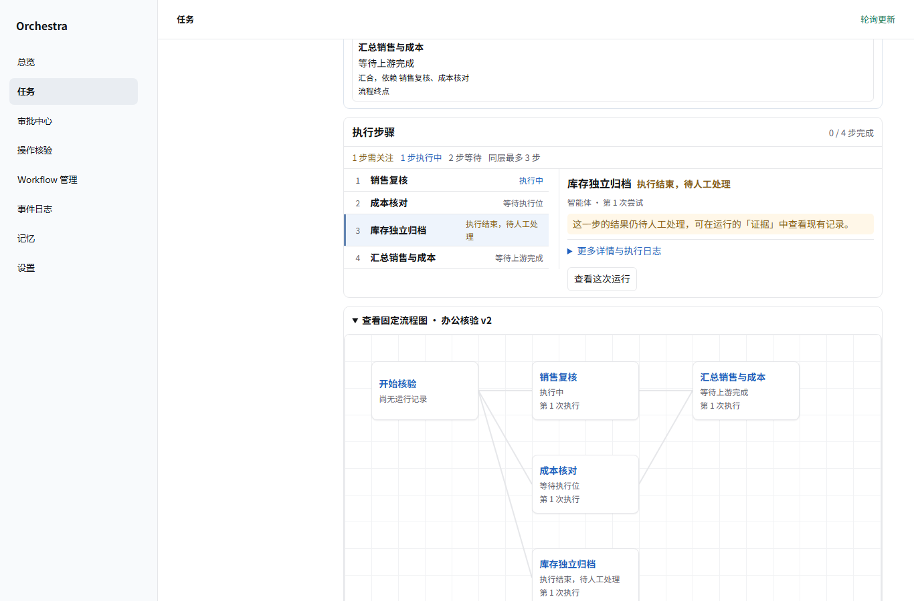
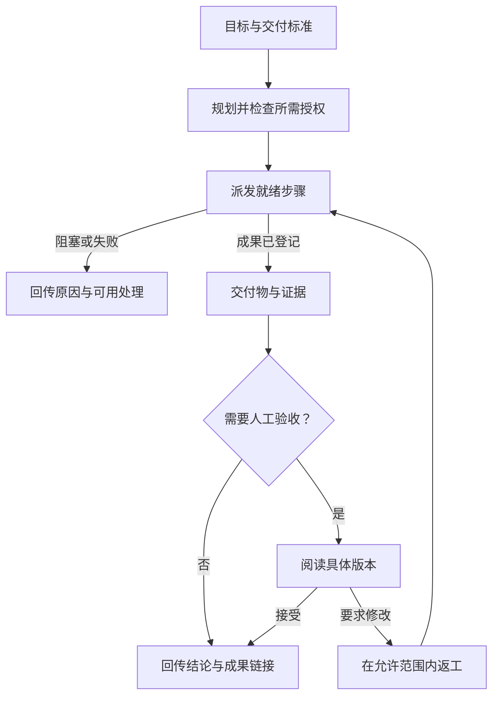
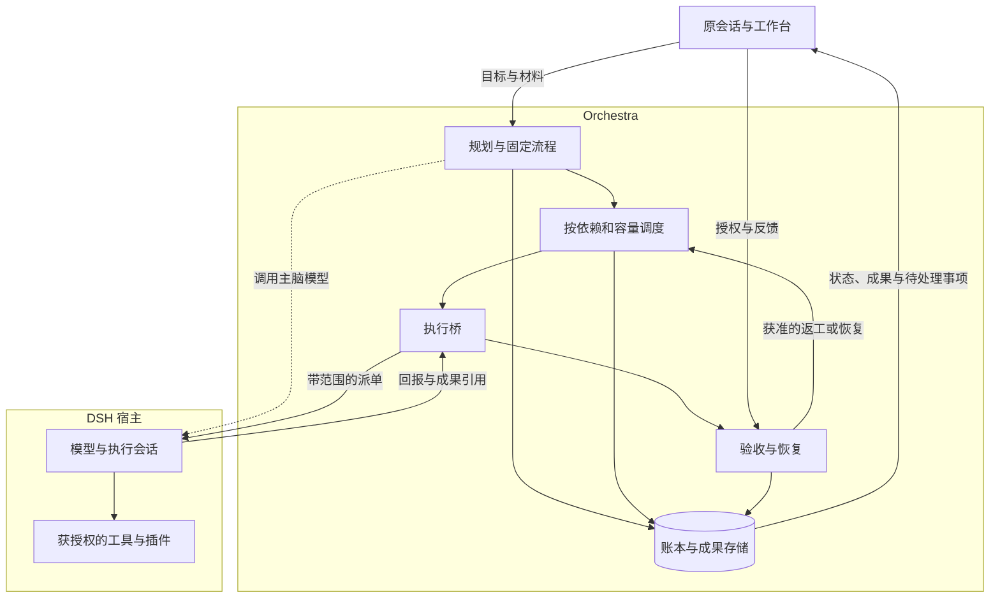

# DSH Orchestra

[简体中文](README.md) · [English](README.en.md)

**从 Agent 的会话管理迈向任务流程管理。**

**交办一个目标，让多个 Agent 按依赖协作，把可核对的成果送回原会话。**

DSH Orchestra 是 DeepSeek Harness（DSH）的工作流编排插件。你描述目标、可用材料和交付要求，Orchestra 将工作组织成步骤：能并行的按容量同时推进，需要汇总的接收指定上游成果。你从一张任务卡跟进进度，打开实际交付物，并把具体版本交回修改。

一个任务包含**计划、依赖、成果和验收标准**。执行会话、模型分工、待处理事项和历次结果都围绕这个任务组织，让较长的工作从交办到验收有据可查。

[为什么用 Orchestra](#为什么用-orchestra) · [一个实际例子](#一个任务四份协同交付的报告) · [快速开始](#快速开始) · [使用指南](#从会话交办到成果验收) · [架构](#架构) · [开发](#开发与验证) · [欢迎提 Issue](#欢迎提-issue)

## 为什么用 Orchestra

| 你希望完成的事 | Orchestra 如何帮你 |
| --- | --- |
| **交办完整任务** | 主脑把目标整理成步骤与交付标准，复用符合条件的已发布流程，或生成任务专属流程。 |
| **让多个 Agent 配合** | 调度器按依赖和容量派发。独立检查可并行，汇总步骤接收它实际需要的上游成果。 |
| **知道工作卡在哪里** | 一张任务卡关联步骤、执行尝试、成果和人工操作。流程图展示依赖，队列说明是在等名额、等上游，还是等你处理。 |
| **拿到可打开的成果** | 已登记成果保留版本和来源。原会话在结果摘要旁提供成果名称链接与原件下载，可继续核对完整内容。 |
| **针对问题修改** | 验收意见绑定具体成果版本。按允许的策略交回产出步骤，或在批准范围内重规划，修订后查看新版本。 |
| **根据记录处理中断** | 回执、事件、执行尝试和证据保留已观察到的事实。恢复与重试依据记录状态和流程规则进行。 |

适合按主题调研后汇总报告、分项核对后生成对账结果，以及需要审核和多轮修改的文档任务。交办时写清允许使用的材料和期待的交付物，后续步骤即可围绕同一目标推进。

## 一个任务，四份协同交付的报告

在一次已记录的 Desktop 验收中，收入、退款和行数分别核对。净额步骤只等待收入与退款报告，行数检查独立完成。



| 交付物 | 已记录的结果 | 配合关系 |
| --- | --- | --- |
| [收入报告](docs/reviews/acceptance/evidence/desktop-1120-b/qa-b-income.md) | 两笔收入，合计 **200.00** | 读取原始样本 |
| [退款报告](docs/reviews/acceptance/evidence/desktop-1120-b/qa-b-refund.md) | 一笔退款，合计 **20.00** | 独立核对原始样本 |
| [行数报告](docs/reviews/acceptance/evidence/desktop-1120-b/qa-b-rows.md) | **3 行数据** | 单独产出核验结论 |
| [净额报告](docs/reviews/acceptance/evidence/desktop-1120-b/qa-b-net.md) | **180.00** | 使用两份已登记的上游报告：200.00 − 20.00 |

原始报告和[桌面运行记录](docs/reviews/acceptance/dispatch-views.md)保留了计算与交接依据。此案例与下方预期为 **109.50** 的快速体验任务使用不同输入。



*历史 Desktop 验收截图，用于展示任务流程；当前 A 版工作台的布局可能不同。*

### 从交办到验收



执行授权和成果验收分别处理。需要授权时展示动作范围；验收时核对实际成果与交付标准。遇到阻塞或失败，依据已有证据和允许的动作处理，图中的返工回路不表示无条件重试。

## 快速开始

### 选择版本并安装

**本 README 描述当前 `main`。** 已发布的 Beta 包是较早的版本快照。要使用当前的任务指令设置、会话成果链接及后续修复，请安装由对应 `main` 提交构建的包；仅看 npm 版本号无法区分这些后续构建。

| 版本 | 获取方式 |
| --- | --- |
| 当前 `main` | 按[源码构建命令](#开发与验证)生成安装包，或使用同时提供对应提交和 SHA-256 的构建包。 |
| 已发布 Beta 快照 | 下载 [`dsh-orchestra-0.1.0-beta.1.tgz`](https://github.com/theBeautifulIce/dsh-orchestra/releases/download/v0.1.0-beta.1/dsh-orchestra-0.1.0-beta.1.tgz)。[预发行页](https://github.com/theBeautifulIce/dsh-orchestra/releases/tag/v0.1.0-beta.1)提供 `SHA256SUMS.txt`；该快照的用法见[对应标签的 README](https://github.com/theBeautifulIce/dsh-orchestra/blob/v0.1.0-beta.1/README.md)。 |

1. 在 **DSH Desktop 插件管理**中安装选定的 `.tgz`，按提示重新加载。侧栏将出现 **Orchestra**。
2. 打开工作区及其中的普通会话。在 **Orchestra → 设置**检查连接、主脑模型、子智能体模型和聊天任务自动接管。个人适配器默认接管明确任务；主脑默认跟随会话模型，也可指定已配置的模型。
3. 发送输入明确、交付要求具体的任务，从任务卡跟进执行并处理必要事项。

插件面向 DSH `0.2.2` 系列。已记录的原生会话派单与审批验收使用 Desktop `0.2.2-rc.5`；完整成果预览面向该版本的原生 Browser 及兼容宿主。本机可用能力以健康页显示为准。

### 试一条结果可核对的任务

开启自动接管后，在工作区会话直接发送以下内容；否则在前面加上当前任务指令，默认为 `/orchestra `。

```text
请完成一项名为「模拟款项核对」的任务。使用我在这条消息提供的两笔模拟收入 83.25、41.75 和一笔模拟退款 15.50，核算净额，保留两位小数。交付本任务专用的 orchestra-sample-net.md，写明输入、算式和结果。不读取或修改已有文件、任务和流程。
```

收到 Orchestra 接单回执后，可在 **任务 → 本次运行 → 结果**打开已登记文件；当前构建也可直接点击原会话中的成果名称。预期净额为 **109.50**。在同一会话点名询问这个任务，即可查询状态。

## 从会话交办到成果验收

### 交办、跟进与修改

- **从会话交办。** 写明目标、允许使用的材料、交付物与验收标准。任务指令可显式派单，关闭自动接管后仍然有效。普通问答继续使用 DSH 会话。
- **从面板规划。** 在 **任务 → 用自然语言规划**先查看计划再启动。重复性工作可选符合条件的已发布流程；草稿支持校验和演练，在途任务保留已固定的流程版本。
- **跟进步骤交接。** 看板、流程、队列和列表展示同一任务的不同信息。打开步骤可查看实际模型、思考强度、执行尝试、耗时和证据。
- **验收具体版本。** 在 **结果 → 交付审核与返工**阅读成果并提交具体意见。留验或修订结果也可向来源会话发出审核通知；接受修订版本后，解除适用的留验状态。
- **依据问题处理执行。** 长时间运行、阻塞和符合条件的反复返工可触发诊断。模型升级需要证据支持和获准的更强模型，详见[返工设计](docs/design/rework-orchestration.md)与[核验后重试记录](docs/reviews/acceptance/f8-plugin-only-2026-11-21.md)。


*历史成果验收截图，用于展示登记成果和审核操作；界面布局以当前 A 版工作台为准。*

### 打开完整成果

当前构建在原会话的摘要旁保留具名成果链接，普通最终回复和后续消息不会隐藏这些入口。点击名称可在 **DSH Desktop 内置浏览器**中打开，也可在会话卡片选择**下载原件**。打开与下载都会核对来源会话和成果的具体版本。

| 内容 | 阅读方式 |
| --- | --- |
| 支持的 UTF-8 文本：Markdown、TXT、JSON、CSV 等 | 浏览器内查看完整内容；超过 256 KiB 的 Markdown 以完整纯文本显示 |
| PNG、JPEG、GIF、WebP | 原生 Browser 内预览图片 |
| HTML、SVG | 查看源码，不执行脚本或自动加载远程图片 |
| PDF、Office 及其他扩展名的文件 | 在会话卡片选择**下载原件** |

成果仍受现有 8 MiB 上限约束。此预览支持原生 Desktop Browser；Web iframe 回退不在支持范围内。阅读链接过期或 DSH 重启后，重新点击同一成果名称即可获取新链接。旧消息缺少成果卡片时，可在原会话查询任务状态。超过保留期或版本不可用时会说明原因。

### 配置任务，保留上下文

| 设置或资料 | 作用 |
| --- | --- |
| 任务指令 | 默认 `/orchestra`，可按 Desktop 用户配置修改。输入后及保存前，对照宿主公开命令、用户可调用技能和客户端命令检查冲突；仅已保存的名称生效。 |
| 执行权限 | 默认全部宿主权限，也可跟随来源会话、由主脑审批或由用户审批。宿主授权、任务范围与节点工具限制仍然有效；修改设置适用于后续执行尝试。 |
| 模型与容量 | 配置五档子智能体模型、能力上限和支持的思考强度，以及会话容量、流程并发和节点／助手上限。 |
| 规划与执行时限 | 设置相应阶段的时间预算，超时后查看具体原因。 |
| 项目资料 | 在获授权工作区根目录放置 UTF-8 纯文本 `ORCHESTRA.md`，写明目标、重要位置和规则。优先安排前 120 行、4 KiB 内的内容；运行在首次派发时固定其快照。 |
| 任务资料与便条 | 步骤接收本次要求和适用的上游成果，限域便条保留运行中的操作信息。 |

启用或停用其他插件后，可重新打开任务指令设置检查。DSH 未公开所有第三方输入规则，公开命令目录之外的规则无法全部核验。

普通执行节点只执行已确认的只读原生工具。

个人 Desktop 适配器支持本机任务接管与执行。独立协作请求、长期记忆写入、共享试用圈和 QQ 值班连接需要可信宿主额外接入。接入记忆服务后，**整理为记忆**仍需核对提案、来源和作用域后批准；项目资料与任务便条可独立使用。

### 任务需要处理时

| 看到的情况 | 下一步 |
| --- | --- |
| 只有聊天回复，没有 Orchestra 接单回执 | 在工作区普通会话检查自动接管与当前任务指令。 |
| 步骤正在等待 | 从队列确认是在等名额、等上游还是等人工，再打开步骤查看详情。 |
| 规划超时，或某档没有可用模型 | 检查模型可用性、能力设置与规划时限。 |
| DSH 关闭或电脑休眠 | 重新打开后检查原任务和恢复操作，再根据记录处理。本机执行依赖宿主持续运行。 |

## 架构

**DSH 提供执行环境，Orchestra 组织任务并记录进展。** 原会话和工作台连接同一份任务记录。



服务是 SQLite 的唯一写入者。经过认证的命令与查询连接面板、原会话和任务状态；事件、回执、证据及成果版本让交接过程可追溯。个人适配器按工作区和会话隔离账本。工具访问仍受 DSH 与相关服务权限约束。

自建宿主通过 `serveDshOrchestra` 接入执行、模型和工具服务，通过 `resolveHttpHuman` 验证人工操作身份，并用 `orchestraPanelTransport` 连接面板。详见[设计说明](docs/design-notes.md)、[运维与回滚手册](docs/runbook.md)及[试用圈指南](docs/trial-circles.md)。

## 开发与验证

使用 [`package.json`](package.json) 声明的 Node 和 pnpm 版本，在仓库根目录执行：

```powershell
pnpm install --frozen-lockfile
pnpm typecheck
pnpm exec vitest run --reporter=dot --maxWorkers=2
pnpm build
New-Item -ItemType Directory -Force .tmp/packages | Out-Null
pnpm pack --pack-destination .tmp/packages
```

将生成的 `.tgz` 安装到目标 DSH 用户配置并重新加载。拉取源码不会自动更新已经安装的插件。自建 Web 宿主可使用 `dsh plugin --profile web add <安装包绝对路径>`，并配置经过认证的宿主传输和权限。

| 目录 | 职责 |
| --- | --- |
| [`src/index.ts`](src/index.ts)、[`src/service`](src/service/) | 宿主接入、规划、流程版本、调度、命令与成果 |
| [`src/executor`](src/executor/) | DSH 执行桥、模型路由、工具与回报 |
| [`src/core`](src/core/)、[`src/infra`](src/infra/) | 流程规则、状态、证据与 SQLite 账本 |
| [`src/client`](src/client/) | 原生会话界面和 Orchestra 工作台 |
| [`tests`](tests/)、[验收索引](docs/reviews/acceptance/README.md) | 单元、契约、集成、界面测试与已记录的验收证据 |

验收记录注明各自验证的候选版本。[Desktop 记录](docs/reviews/acceptance/desktop.md)、定向检查和短时观察不能替代正式的 24 小时浸泡或 72 小时 R0 观察；发布状态以同一冻结候选的证据为准。

## 许可证

源码按 [PolyForm Noncommercial License 1.0.0](LICENSE) 允许的用途提供，商业使用需另行取得权利人的授权。DSH、依赖和模型服务各有其使用条款。[PolyForm 官方条款](https://polyformproject.org/licenses/noncommercial/1.0.0)。

## 欢迎提 Issue

**有希望 Orchestra 做得更好的任务？欢迎告诉我们。**

[提交 Issue](https://github.com/theBeautifulIce/dsh-orchestra/issues/new) · [查看已有 Issues](https://github.com/theBeautifulIce/dsh-orchestra/issues)

- **发现 Bug：** 请提供 DSH 与插件版本或提交号、操作系统、复现步骤、预期和实际结果，以及相关的脱敏日志或截图。
- **提出功能建议：** 说说你要完成什么任务、哪一步不顺，以及希望得到什么结果。
- **改进体验或文档：** 指出哪处页面、提示、图或说明不清楚，以及你原本期待看到什么。

提交前请移除凭据和私人任务材料。具体的使用案例能帮助我们把从交办到交付的每一步做得更好。
