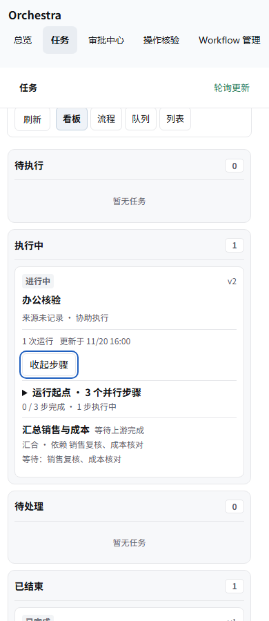
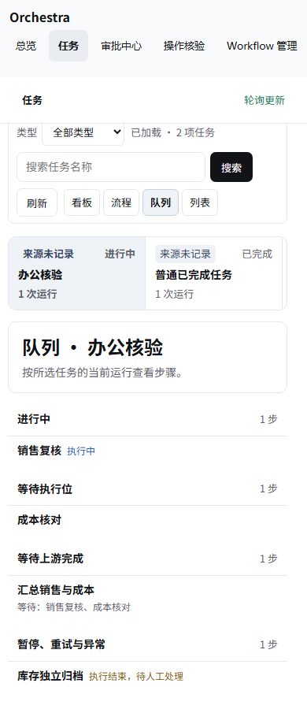

# DSH Orchestra

[简体中文](README.md) · [English](README.en.md)

**在 DSH 发出一条任务，让能并行的步骤一起做，在原会话收到可核对的交付结果。**

DSH Orchestra 是 DeepSeek Harness（DSH）的工作流编排插件。你描述目标、可用材料和交付要求，主脑生成计划，给步骤分配模型和执行名额。你可以从同一张任务卡查看每步状态、打开实际交付物，并在需要判断时批准执行、核对成果或填写修改意见。

- **对账与复核** · 收入、退款和抽样检查分别进行，等需要的结果齐全后生成汇总。
- **调研与文档** · 按主题分工整理材料，汇总步骤引用已登记的上游成果。
- **需要反复打磨的交付** · 先看报告和审核标准，发现问题就把具体意见交回产出步骤，修订后再看新版本。

[快速开始](#快速开始) · [能力编排](#能力编排) · [架构](#架构) · [使用指南](#使用指南) · [开发与验收](#开发与验收) · [许可证](#许可证)

*隔离验收截图。销售复核和成本核对共同输入汇总步骤，独立归档有自己的状态。*

## 快速开始

### 安装

1. 下载 [`dsh-orchestra-0.1.0-beta.1.tgz`](https://github.com/theBeautifulIce/dsh-orchestra/releases/download/v0.1.0-beta.1/dsh-orchestra-0.1.0-beta.1.tgz)。[预发行页](https://github.com/theBeautifulIce/dsh-orchestra/releases/tag/v0.1.0-beta.1)同时提供 `SHA256SUMS.txt`，可先核对再安装。本版面向 DSH `0.2.2` 系列，原生会话派单与审批在 **DSH Desktop `0.2.2-rc.5`** 验证。只有需要自己构建时才看[源码构建](#开发与验收)。
2. 在 DSH Desktop 的插件管理里安装这个包，按宿主提示重新加载。侧栏出现 **Orchestra** 后，打开一个工作区及其中的普通会话。
3. 在 **Orchestra → 设置** 检查服务连接、模型和 **聊天任务自动接管**。个人 Desktop 适配器默认开启明确任务的自动接管。主脑默认跟随会话，也可指定已配置的供应商、模型及可用的思考强度。子智能体模型单独设置。
4. 其他 DSH 宿主的加载和能力以本机健康页与宿主装配为准。

### 在原会话发一条合成任务

如已开启自动接管，直接发送以下消息即可。关闭自动接管的情况下，在消息前加 `/orchestra `。普通问答沿用 DSH 会话。

~~~
请完成一项名为「模拟款项核对」的任务。使用我在这条消息提供的两笔模拟收入 83.25、41.75 和一笔模拟退款 15.50，核算净额，保留两位小数。交付本任务专用的 orchestra-sample-net.md，写明输入、算式和结果。不读取或修改已有文件、任务和流程。
~~~

发送后看是否收到 **Orchestra 已接单**。可以在 **任务 → 本次运行 → 结果** 打开已登记的文件。预期净额是 **109.50**。有需要你处理的审批、阻塞或结论时，Orchestra 会在适用的原会话通知你。也可以在任务面板看进度，或在原会话点名询问。

## 设计理念

- **计划先行，执行有边界。** 主脑建议工作流、分工、模型和交付条件。固定版本、工具范围、人工授权与启动回执由服务校验。
- **一个任务保留一张卡。** 任务卡展开具名步骤，流程图解释依赖与汇合，队列解释等待上游、等待名额或待人工处理。并行规模由任务图和容量决定。
- **两层资料随派单复用。** 项目结构和约束按版本固定，本次目标、验收条件和必要的上游结果随节点派发。
- **授权与验收分开。** 启动或执行授权需要明确同意。成果审核需要先读交付物，再通过验收或退回具体修改意见。
- **恢复依据可核验的事实。** 超时、断连和迟到回报各有记录。执行是否开始、外部影响是否发生、是否允许重派，均以宿主证据和已发布流程规则判定。

## 能力编排

~~~mermaid
flowchart TD
    T["一个任务 · 一个固定计划"] --> S["共同前置 · 数据与验收条件"]
    S --> A["收入核对"]
    S --> B["退款核对"]
    S --> C["独立抽查"]
    A --> J["汇合 · 只等待已声明的依赖"]
    B --> J
    C --> R["单独的核验结论"]
    J --> D["交付汇总结果"]
    R --> D
    D --> H{"需要人工留验？"}
    H -->|是| V["核对成果与审核标准"]
    V -->|要求修改| F["将具体意见交回原步骤"]
    F --> N["按策略修订并产出新版本"]
    N --> V
    V -->|通过| E["验收并登记结论"]
    H -->|否| E
~~~

| 能力 | 实际使用方式 |
| --- | --- |
| 自然语言派单 | 本机普通会话自动接管明确任务。`/orchestra` 可显式派单，关掉自动接管后仍可使用。面板可先核对计划再启动。 |
| 工作流版本 | 草稿编辑、校验、演练、发布与停用。每次运行绑定已发布版本。任务可复用符合条件的流程或生成任务专属流程。 |
| 节点与并行 | 支持智能体、等待、人工审批、策略、条件分支、受信工具、子流程和专用并行组等节点，按发布与宿主能力校验。并行组在满足拓扑约束时可等待全部、任一或指定数量的分支。 |
| 模型与容量 | 子模型分为常规、中等、进阶、复杂、专家五档。可填写模型最大能力、用途及支持的思考强度。可调整会话容量、流程并发、同节点跨运行并发和单节点助手上限。 |
| 执行诊断 | 查看实际模型、思考强度、执行尝试、耗时和证据。对长时间、阻塞或反复退回可触发诊断，在存在获准的更强模型且证据支持时按约束升级。 |
| 成果验收与返工 | 运行的结果页提供登记成果、文本预览、原件下载和验收依据。人工意见绑定具体版本，可针对原步骤修改或按受控范围重规划。 |
| 协作核验 | 为有依赖关系的步骤授权独立核验，由审核方采纳或驳回证据和结论。 |
| 资料、便条和记忆 | 版本化项目资料与任务派单资料服务于当前运行。共享或限域便条记录运行中的信息。经批准的长期记忆由宿主记忆插件保存。 |
| 可恢复执行 | 事件、回执、执行尝试和产物在账本中关联。支持按规则继续观察、确认未启动或核验外部结果后处理。允许核实后重试的步骤还需满足固定版本与证据条件。 |

  
  

*在同一个合成任务上，看板聚合步骤，队列给出每项等待的原因。*

## 架构

~~~mermaid
flowchart TD
    U["操作人 · DSH 原会话 / Orchestra 面板"]
    subgraph DS["DSH 受信宿主"]
        G["已认证的工作区和会话"]
        M["模型目录 · 子会话 · 受权工具"]
    end
    subgraph OR["Orchestra 插件"]
        P["任务规划 · 交付与权限校验"]
        W["发布版本 · 拓扑及依赖"]
        D["调度器 · 并发名额 · 执行尝试"]
        X["DSH 执行桥"]
        C["审批 · 成果审核 · 核验与恢复"]
        L[("SQLite 单写者账本 事件 · 回执 · 证据 · 产物")]
        Q["查询和事件订阅"]
    end
    U --> G --> P --> W --> D --> X --> M
    P -.->|规划模型调用| M
    M --> X --> C
    D --> C
    C -->|审批通过、验收或受控重派| D
    P --> L
    W --> L
    D --> L
    C --> L --> Q --> U
~~~

1. **接单与计划。** 将请求绑定到当前工作区和会话。主脑返回待校验的计划，Orchestra 复核目标、交付、依赖、工具和风险。
2. **固定版本与调度。** 将运行绑定至计划和工作流定义。调度器读取依赖与可用名额，只派发满足条件的步骤。
3. **执行与结算。** 通过 DSH 执行桥创建隔离子会话，将相关资料和获准工具交给节点。执行回报、用户决定、成果与证据分别入账。
4. **查看与恢复。** 面板通过有鉴权的查询和事件订阅读取投影。会话只推送该任务需要人关注的事项和终态。恢复必须归属原尝试，相关动作按账本事实结算。

SQLite 写入由服务统一处理。面板通过受信传输访问查询和命令。个人宿主的账本按工作区与会话隔离，默认在 DSH 数据目录下的 `orchestra/personal`。自管宿主把通过验证的登录身份绑定到审批、协作和返工命令。所用模型或工具可访问哪些资料，由宿主授权和各自服务策略决定。

## 使用指南

### 启动、查看、处理

~~~mermaid
sequenceDiagram
    actor User as 操作人
    participant Chat as DSH 会话
    participant Engine as Orchestra
    participant Worker as 子智能体
    User->>Chat: 提交任务与交付条件
    Chat->>Engine: 绑定来源会话并生成计划
    opt 计划要求启动授权
        Engine-->>Chat: 显示授权范围和后续动作
        User->>Chat: 确认启动
    end
    Engine->>Worker: 按依赖与名额派发
    Worker-->>Engine: 登记成果与执行证据
    opt 步骤要求人工留验
        Engine-->>Chat: 推送待审成果与审核标准
        User->>Chat: 查阅成果并通过或填写修改意见
        opt 要求修改
            Chat->>Engine: 提交绑定当前成果版本的意见
            Engine->>Worker: 按策略安排原步骤返工
            Worker-->>Engine: 登记修订版
            Engine-->>Chat: 推送新一轮审核
        end
    end
    Engine-->>Chat: 回传已登记的处理结果
~~~

- **从会话派单。** 写清任务目标、可以用的材料、要交付的内容和验收条件。关闭自动接管后，`/orchestra 任务内容` 仍能明确派单。空命令只显示用法。
- **从面板规划。** 在 **任务 → 用自然语言规划任务** 检查交付物、权限和流程安排，再确认启动。熟悉的流程可以从已发布版本创建任务。
- **看并行。** 在 **任务** 切换看板、流程、队列或列表。打开单条运行可看步骤尝试、结果、证据和事件。
- **审批与返工。** 在会话或 **审批中心** 处理启动与执行授权。在运行的 **结果 → 成果审核与返工** 查看此版本的交付并填写意见。已标记人工留验、或待复验的修订成果，在支持该能力的会话版本中还会收到结构化的原会话提醒，并可打开短文本预览、文件和反馈表单。通过修订版按当前版本结清留验。
- **核实后重试。** 在流程草稿选择对应智能体步骤，显式打开 **核实后允许重试**，发布后用于绑定该版本的新运行。现场证据和审批支持范围见 [F8 专项验收](docs/reviews/acceptance/f8-plugin-only-2026-11-21.md)。

*隔离 Desktop 验收截图。结果页给出实际登记的合成成果及操作入口。*

### 共享资料和设置

在获准工作区根目录创建普通 UTF-8 文本 `ORCHESTRA.md`，写下项目目标、关键目录和验证规则。把优先内容放在最前 120 行和 4 KiB 内。首次派单固定本次运行采用的版本，后续节点复用同一份。运行侧会另附本次要求与必要的上游成果引用。

在 **设置** 可调整主脑和执行模型、自动接管、规划与执行时限、排队容量及 Workflow 并发。模型目录与能否设置思考强度由 DSH 提供。开通的工具决定子智能体能读什么。个人适配器的 `local.allowWorkspaceListing` 默认关闭，只授权列出允许的一级条目。`local.sampleFile` 可在宿主配置中指定一个明确授权的文本文件供验收读取。

### 个人 Desktop 与自管宿主

| 运行方式 | 适用范围 |
| --- | --- |
| 个人 DSH Desktop | 适用于本机工作区中的会话派单、规划、选模、任务查看及受支持的人工处理。个人适配器不装配共享试用圈、长期记忆写入或值班 QQ。 |
| 自管受信 DSH 宿主 | 通过 `serveDshOrchestra` 提供隔离的数据路径、阶段、已授权的会话与执行器、模型目录和工具注册表。以 `resolveHttpHuman` 绑定真实操作人，由 `orchestraPanelTransport` 向客户端提供已认证的工作区接口。可另行装配记忆、协作核验和通知适配器。 |

启用长期记忆时，可在成功运行的结果页选择 **整理为记忆**。先审阅提议、来源及写入范围，再批准写入。项目资料和运行便条不要求先写入长期记忆。共享试用的能力边界、发布与恢复操作分别见 [试用圈](docs/trial-circles.md) 和 [值班与回滚手册](docs/runbook.md)。

### 首次使用常见问题

| 看到的情况 | 从哪里排查 |
| --- | --- |
| 会话回答了，但没有 Orchestra 受理回执 | 在设置检查聊天任务自动接管，确认使用普通工作区会话。可用 `/orchestra` 单次指定派单。 |
| 某一步一直等着 | 在队列查看它在等名额、上游还是人工处理。展开步骤可以查看实际选模和阻塞原因。 |
| 规划超时或某档没有候选模型 | 在设置查看主脑、当前可用模型及已评估的能力，再根据任务调整规划时限。 |
| 办公电脑休眠或退出了 DSH | 本机执行依赖宿主运行。重新打开后先查看原运行记录与恢复待办，再决定下一步。 |

## 开发与验收

| 路径 | 职责 |
| --- | --- |
| [`src/index.ts`](src/index.ts) 和 [`src/service`](src/service/) | 宿主装配、计划、版本、调度、命令、证据与运行查询 |
| [`src/executor`](src/executor/) | DSH 子会话执行桥、模型路由、工具与执行回报 |
| [`src/core`](src/core/) 和 [`src/infra`](src/infra/) | 工作流定义、规则、状态和 SQLite 账本 |
| [`src/client`](src/client/) | DSH 侧栏、原生会话工具视图与运行面板 |
| [`tests`](tests/) 和 [验收索引](docs/reviews/acceptance/README.md) | 单元、契约、集成、面板测试与实际验收记录 |

源码构建使用 [`package.json`](package.json) 中锁定的 pnpm 和 Node 版本。下面的命令从仓库根目录运行，以 PowerShell 为例。

~~~powershell
pnpm install --frozen-lockfile
pnpm check
New-Item -ItemType Directory -Force .tmp/packages | Out-Null
pnpm pack --pack-destination .tmp/packages
~~~

将输出的 `dsh-orchestra-*.tgz` 安装到选定的 DSH profile。Web 自管环境可用 `dsh plugin --profile web add <tgz 的绝对路径>`，再在该 profile 装配已认证的面板传输和工作区权限。已安装的 DSH 宿主按自己的依赖管理器安装插件包。

查看 [设计说明](docs/design-notes.md)、[返工设计](docs/design/rework-orchestration.md)、[派单和视图验收](docs/reviews/acceptance/dispatch-views.md) 及 [桌面验收](docs/reviews/acceptance/desktop.md)。S6 的 24 小时浸泡和 72 小时 R0 观察是单独的正式验收项。短窗、局部回归或插件实装各自保留证据，发布状态以同一候选的验收记录为准。

## 许可证

本项目提供源码，允许按许可证免费用于非商业用途。商业使用需要权利人另行授权。复制、修改、分发及许可证所列的适用情形以随包的 PolyForm Noncommercial License 1.0.0 原文为准。DSH、第三方依赖和模型服务遵循各自的条款。 [许可证原文](LICENSE) · [PolyForm 官方说明](https://polyformproject.org/licenses/noncommercial/1.0.0)
