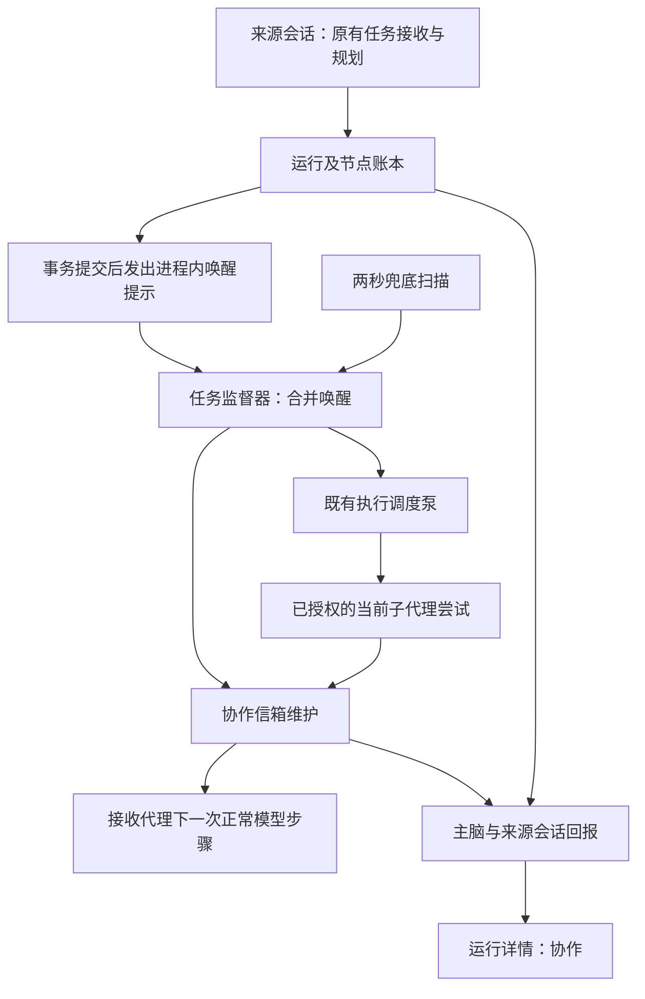

# 任务监督器与代理协作信箱

## 设计范围

S6 默认接入本能力。原有任务、运行、节点、审批、执行权限、结果验收、返工、正式核验和证据账本仍是唯一的执行事实来源。新的监督器负责唤醒和隔离，信箱负责同一次运行内的参考信息交换与问题升级；二者不自行修改工作流、扩大工具授权、签认结果或重派执行。

### 执行链

- 事件提示只在事务成功提交后发出。它不是持久投递确认。原有恢复和定时扫描仍然有效；启动、崩溃、进程外写入不依赖内存提示的存续。
- 50ms 合并唤醒触发既有调度泵，避免每条工具事件都重新调度。到期、恢复和其他维护任务仍使用两秒兜底，单个维护任务异常不阻断其他任务。
- 来源会话独立回报泵，保留原有可见事件确认与重投。同一慢会话不会使其他会话的回报泵等待。
- 新消息最多在接收代理的下一次**正常模型步骤**注入四条，并以记录 ID 和修订号生成稳定标识。若该尝试没有下一步，不为消息单独唤醒模型、制造等待或消耗执行槽。

## 协作工具

`orchestra_coordination` 只向已授权、当前活跃、未超时、未被围栏的 S6 原生纯执行节点提供。子代理通过 `inbox` 获取同运行可联系节点及记录，不自行猜测节点编号。`send` 支持四类：

| 类型 | 目标 | 行为 |
|---|---|---|
| finding | 主脑／操作人 | 记下参考发现 |
| blocker | 主脑／操作人 | 主动上报缺口，进入待关注和来源会话通知 |
| request | 当前同行 | 请求协助或核对参考事实 |
| handoff | 当前同行 | 传达轻量参考交接，不替代正式成果发布 |

`reply` 和 `withdraw` 必须携带当前记录 ID 与修订号；完全相同的重发安全去重。每条正文或回复最多 500 字，请求默认 120 秒、可设置 30–300 秒；每节点运行最多 12 条、每运行最多 64 条、同一运行同时最多 8 条待回应请求。循环求助被拒绝。取消、围栏、失联、尝试替换或期限结束时，尚未处理的请求会收口并显示原因。消息不会暂停或恢复任何节点。仍须在原任务的完成回报里表达缺口、未完成项及下一步。

## 权限、证据及数据边界

- 绑定 `run_id / node_run_id / attempt / action_generation / executor_session_id`、当前租约、写入 epoch、已签名模型确认记录。只允许同一运行内有权交流的当前尝试。原有正式核验工具仍保留，协调信息不等于核验证据。
- 存在运行内或祖先运行节点专属材料时，不允许自由文本转发给同行；可通过原授权的成果/材料流程交接，或向本运行可信人工负责人上报。所有协作内容均为不可信参考资料，不是权限、命令或成果验收依据。
- 协作记录独立保存，更新使用修订号 CAS，HMAC 与账本摘要绑定；通用事件只存标识、状态和摘要，不包含正文。
- 人工端只能读取归属自己的运行和标记知悉。标记知悉只表明看过，不是批准、解锁或认定问题已解决。
- 迁移 080 为新增表与索引；001–079 未改。源码回滚不等于数据库回滚，安装新版前备份 Desktop 插件数据。

## 使用与现场验收

任务的运行详情增加「协作」标签，与原「便条」分离。可读待关注、请求、回复、期限及收口原因。主脑/原会话在新问题、等待超时或同行不可用时收到可定位提示。已有任务的审批与成果链接不应消失。

实际 DSH Desktop 用以下固定场景验收：

1. 两个并行只读步骤 A/B。A 发出求助，B 在自己的正常模型步骤收到并回应；A 收到回应或在原任务结束后如实结束，不阻塞整个任务。
2. B 提前结束或超时、A/B 形成循环求助。检查拒绝或收口、来源会话和协作页、无额外执行尝试。
3. 在等待期间取消、切换会话、重启、撤回材料权限。旧尝试不得读写新尝试的消息。节点专属材料不得借信箱越权传给同行。
4. 已有审批、成果审核/返工、结果卡、普通问答、临时/固定工作流照常使用。
5. 在相同模型、工作流和输入上比较调度延时、回报延时、模型调用数及真实 token；不把静态提示长度或事件测试冒充 token 实测。

此版本不引入跨运行聊天、任意模型自主重写 DAG、协作等待型节点、额外的模型轮询、自动签认或独立协作成果验收。主脑仍使用原有规划和审批能力；新信箱不自动为不存在或已结束的同行创建任务。后续是否做结构化自动重规划、持久化未接单语义草稿，需依据实际任务和验收证据设计，不能在本次附带更改原执行权威。
